<div align="center">


# Keepframe

**From memory card to a clean library — fast, offline, and without ever deleting a photo.**

Import with checksum verification · cull bursts and blurry shots by swiping · browse your whole library · know when it's safe to format the card.

[Download](https://github.com/adobrov-cloud/keepframe/releases) · [Русская версия](README.ru.md)

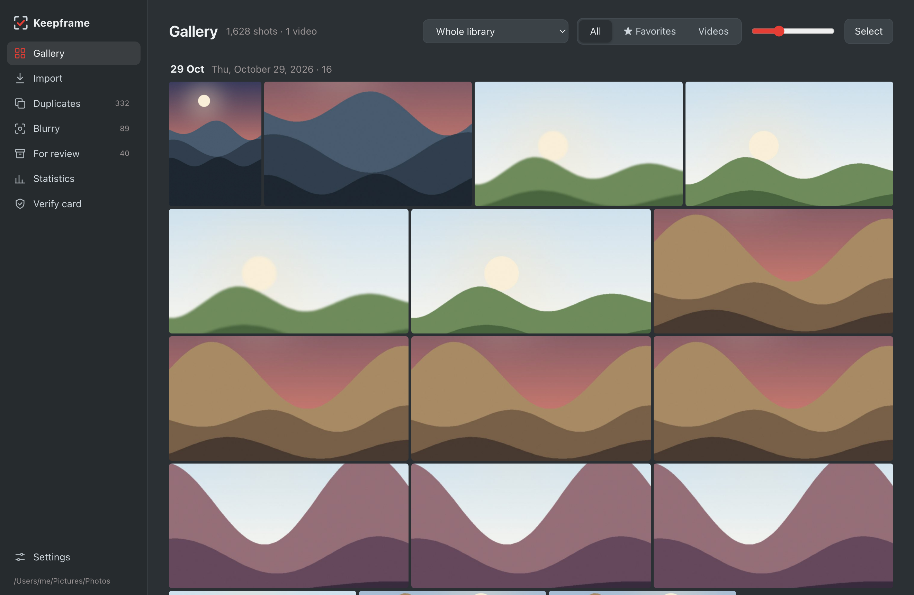

</div>

---

## Why

A day of shooting easily produces hundreds of frames: bursts of near-identical shots, a few soft ones, JPG + RAW pairs, a couple of videos. Sorting that in Finder is slow, and formatting the card always comes with a nagging *"did everything actually copy?"*

Keepframe turns that into a routine of a few minutes:

1. **Insert the card** — new shots are copied into per-day folders, each copy verified by SHA-256.
2. **Swipe** — keep or reject every new shot, or let the app find bursts and blurry frames for you.
3. **Verify** — the app compares every file on the card with the library by content and tells you plainly: *safe to format*.

Nothing is ever deleted. Rejected shots go to `_review (…)` folders next to your library, every move can be undone, and you empty those folders yourself when you're sure.

## Use cases

**🧳 After a trip or a weekend.** Turn on *Mindful import*: copying runs first, then you swipe through the new shots — → keep, ← reject. Rejected shots and their RAW files go to review. Eject the card when the app says it's safe.

**👶 Kids, pets, sports — lots of bursts.** *Duplicates* groups shots taken within seconds that look alike and pre-selects the sharpest one. Scroll to zoom all shots of a burst at once on the same spot — compare eyes, not thumbnails.

**🌙 Low light and slow shutter.** *Blurry* finds frames noticeably softer than the rest of the same day and shows the sharpest 100 % crop of each, so motion blur and missed focus are obvious at a glance. *Statistics* then tells you why: ISO, shutter and aperture habits, and concrete settings to change.

**🗂 Finding the keepers.** The *Gallery* shows the whole library by day, with videos. Star favourites, multi-select with Shift/⌘, reject in bulk, open in Preview or reveal in Finder.

**💾 Before formatting the card.** *Verify card* hashes every file on the card — including videos the camera keeps outside `DCIM` and formats the app doesn't know — and lists anything missing. A checksum file is saved with the library.

**🗄 Two copies before formatting.** Point Keepframe at an external drive or NAS and every import goes there too, verified by checksum. *Verify card* then checks the backup as well, and one button brings the backup up to date with the whole library.

**⭐ Working with Lightroom or Capture One.** Ratings 1–5 and colour labels (keys 1–5 and 6–9, as in Lightroom) are written to XMP sidecars next to the RAW, so the other app sees your picks. Your photos are never modified.

**🕑 Camera clock was off.** Set the offset at import, or select shots later and shift their time: shots move to the right day folder together with their RAW, and the corrected time goes into the sidecar. Undo works as for any move.

**📷 Any camera.** JPG, HEIF and RAW from Fujifilm, Canon, Nikon, Sony, Olympus, Panasonic, Pentax, Leica, Hasselblad, Sigma, GoPro, DJI… RAW-only shooters get the full experience too: the app uses the full-size preview every camera embeds in its RAW files.

## Features

<table>
<tr>
<td width="50%">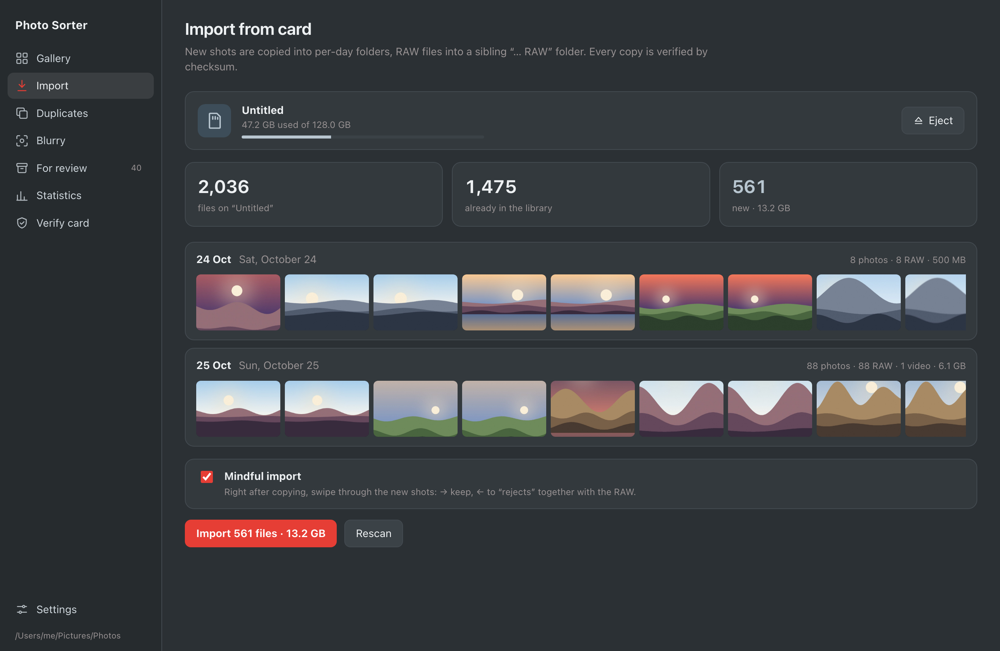</td>
<td width="50%">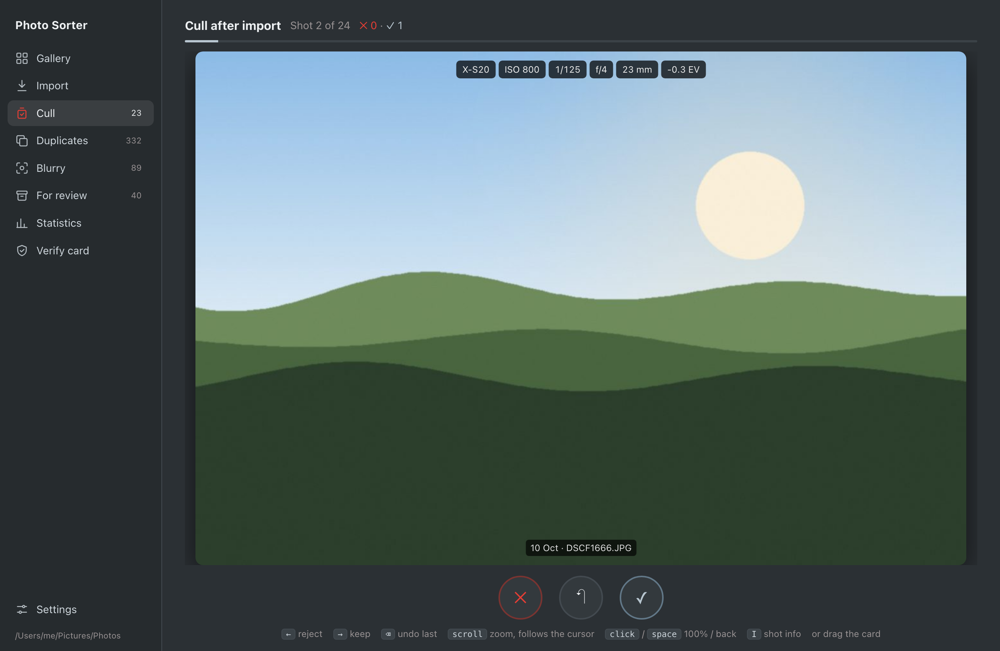</td>
</tr>
<tr>
<td><b>Import</b> — detects the card, shows what's new by day with previews, copies with verification. Card capacity and an Eject button included.</td>
<td><b>Mindful import</b> — right after copying, swipe through the new shots: keep or reject. Drag the card or use the arrow keys.</td>
</tr>
<tr>
<td>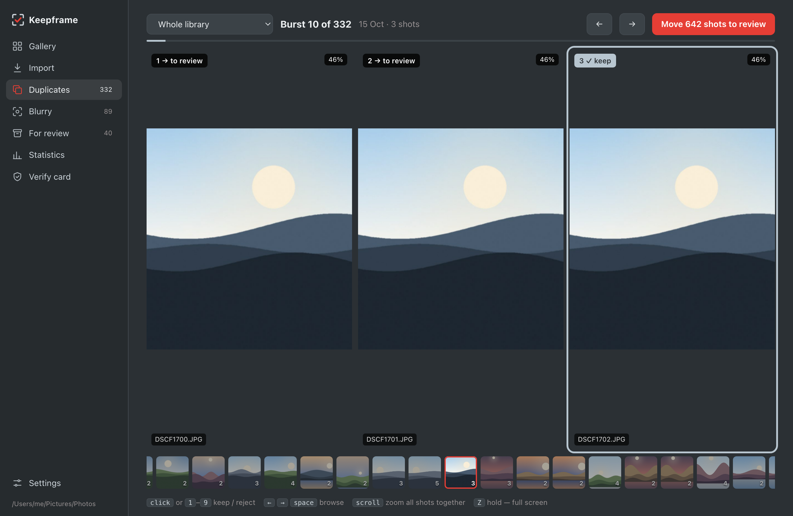</td>
<td>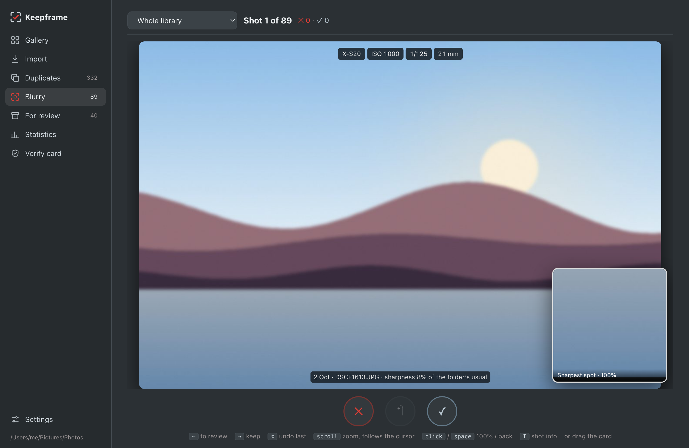</td>
</tr>
<tr>
<td><b>Duplicates</b> — one burst per screen, the sharpest pre-selected, synced zoom across all shots, a filmstrip of all bursts below.</td>
<td><b>Blurry</b> — swipe through soft shots; a loupe shows the sharpest spot at 100 %, shot info on top.</td>
</tr>
<tr>
<td>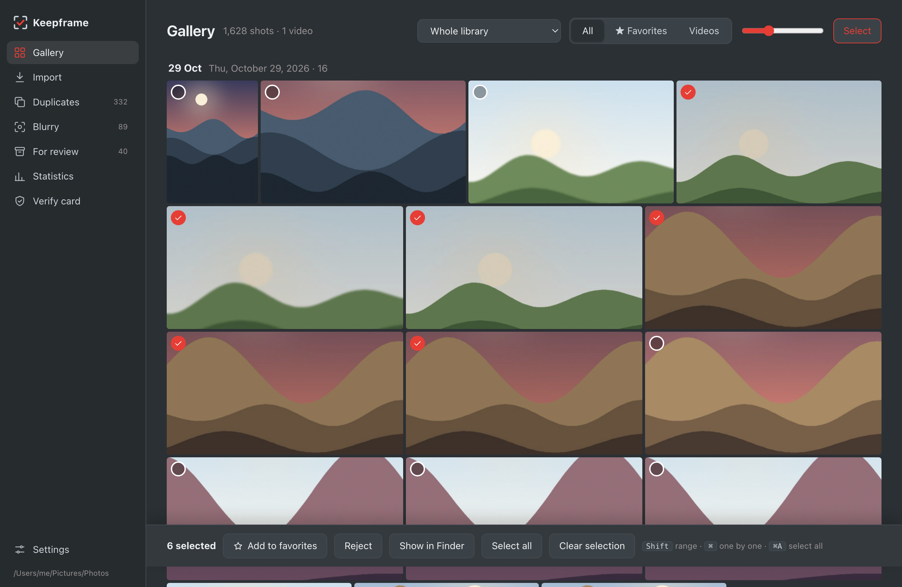</td>
<td>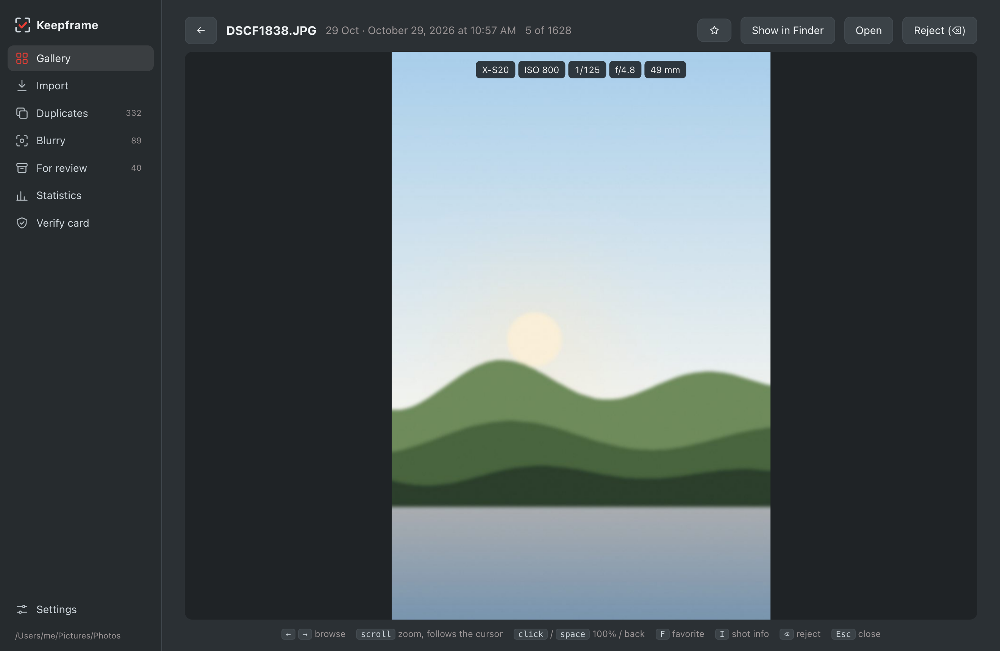</td>
</tr>
<tr>
<td><b>Gallery</b> — the whole library by day, photos and videos, favourites, multi-select and bulk actions.</td>
<td><b>Viewer</b> — arrows to browse, scroll to zoom (the zoomed area follows the cursor), click for 100 %, F to star.</td>
</tr>
<tr>
<td>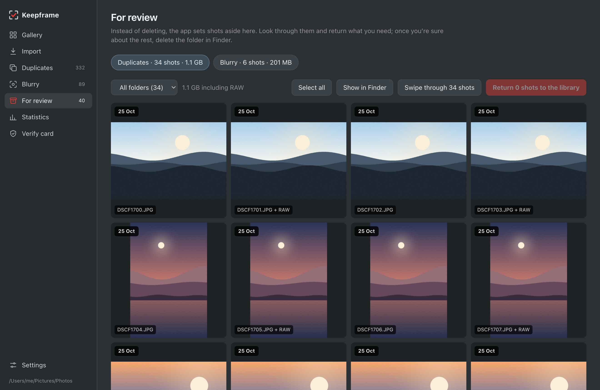</td>
<td>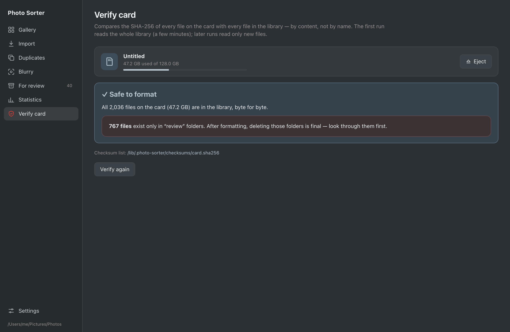</td>
</tr>
<tr>
<td><b>For review</b> — everything set aside, by kind and day. Return shots to their folders one by one, in bulk, or by swiping.</td>
<td><b>Verify card</b> — every file on the card checked against the library by SHA-256, not by name.</td>
</tr>
<tr>
<td>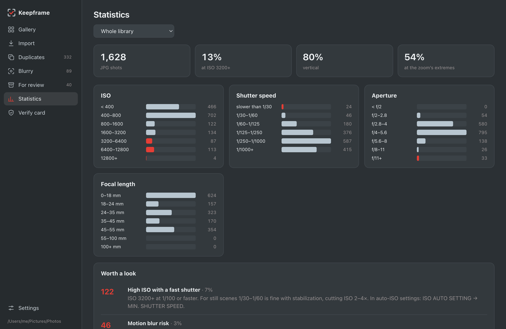</td>
<td>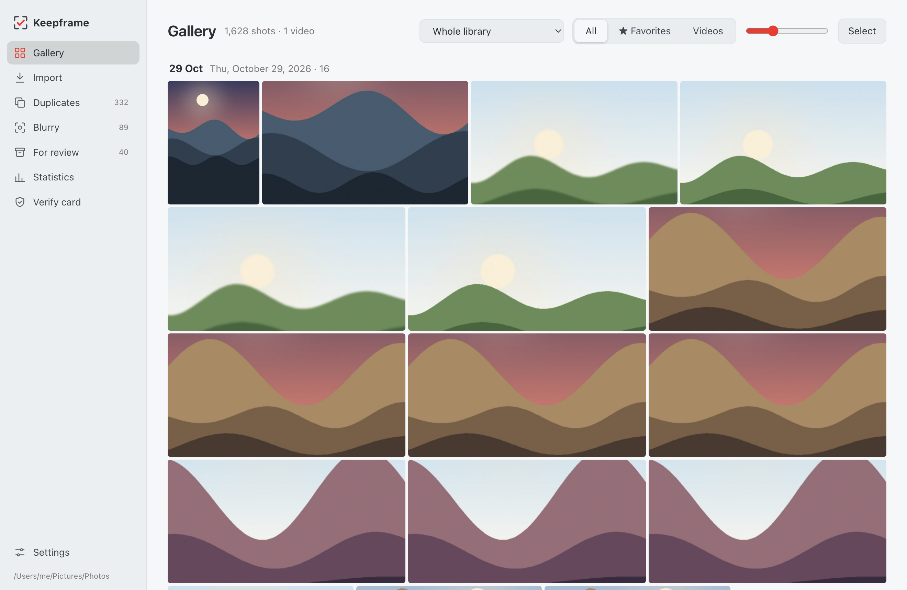</td>
</tr>
<tr>
<td><b>Statistics</b> — ISO, shutter, aperture and focal length distribution with practical advice.</td>
<td><b>Light and dark</b> — follows the system theme. Native macOS window with sidebar vibrancy.</td>
</tr>
</table>

**13 languages:** English, Русский, Українська, Español, Português, Français, Deutsch, Italiano, Polski, Türkçe, 简体中文, 日本語, 한국어.

## Keyboard

| | Swipe screens (Blurry, Mindful import, Return from review) | Duplicates | Gallery viewer |
|---|---|---|---|
| ← / → | reject / keep | previous / next burst | previous / next |
| Scroll | zoom, follows the cursor | zoom all shots together | zoom |
| Click, Space | 100 % / back | click: keep / reject; Space: next | 100 % / back |
| ⌫ | undo last decision | — | reject |
| 1–9 | — | keep / reject shot N | — |
| I | shot info | — | shot info |
| F | — | — | favourite |
| 1–5, 0 / 6–9 | — | — | rating / colour label (also for a gallery selection) |
| Z (hold) | full screen | full screen | — |
| Esc | reset zoom | reset zoom | close |

In the gallery: **Shift-click** selects a range, **⌘/Ctrl-click** toggles one, **⌘/Ctrl-A** selects everything shown.

## Install

Get the build for your system from [Releases](https://github.com/adobrov-cloud/keepframe/releases):

| System | File |
|---|---|
| macOS, Apple Silicon | `Keepframe_x.y.z_aarch64.dmg` |
| macOS, Intel | `Keepframe_x.y.z_x64.dmg` |
| Windows | `Keepframe_x.y.z_x64-setup.exe` |
| Linux | `.deb`, `.rpm` or `.AppImage` |

The app isn't signed with a paid Apple / Microsoft certificate yet:

- **macOS** — on first launch open *System Settings → Privacy & Security* and click *Open Anyway*. If macOS says the app is damaged, run `xattr -cr "/Applications/Keepframe.app"` in Terminal.
- **Windows** — SmartScreen may warn about an unknown publisher: *More info → Run anyway*.

## How it works

Everything runs locally: no network access, no account, no telemetry.

| | |
|---|---|
| **Copy verification** | Each file is hashed (SHA-256) while copying; the copy is read back and compared before it gets its final name. |
| **Card check** | Every file on the card except camera housekeeping (databases, thumbnails, proxies) is hashed and looked up in the library by content. Library hashes are cached, so later checks only read new files. |
| **Bursts** | A 64-bit difference hash (dHash) per shot; neighbours taken ≤ 15 s apart with a Hamming distance ≤ 12 form a burst. |
| **Sharpness** | Variance of the Laplacian in the sharpest of 16 tiles (a sharp subject on a soft background still counts as sharp), compared with the rest of the same day. |
| **RAW and HEIF** | RAW files give up the full-size JPEG preview embedded by the camera; HEIF is converted with the system `sips` on macOS. |
| **Safety** | Moves go to `_review (…)` folders with a journal for undo; favourites and caches live in `<library>/.photo-sorter/`. Photos are never modified or deleted. |

Built with [Tauri 2](https://tauri.app) (Rust) and plain HTML/CSS/JS — about 12 MB installed.

## Build from source

Requires [Rust](https://rustup.rs) and Node.js.

```bash
npm install
npx tauri dev                    # run in development
npx tauri build --bundles app    # macOS .app in src-tauri/target/release/bundle
```

Windows and Linux build the same way (`npx tauri build`). Pushing a `v*` tag builds all platforms on GitHub Actions and publishes a release.

**Tests.** An end-to-end backend test runs on real files — `PS_CARD` is a folder with `DCIM`, `PS_LIB` an empty library folder:

```bash
cd src-tauri && PS_CARD=/path/to/card PS_LIB=/tmp/lib cargo test --release -- --nocapture
```

**UI without the backend.** Serve the repo root (`python3 -m http.server`) and open `/mock/index.html` — the mock answers every backend call with demo data. `?scene=gallery&lang=en` opens a prepared screen; that's how the screenshots above are made. The demo pictures are generated landscapes, not real photos.

## Roadmap

- “RAW only for the best”: free space by setting aside RAW files of shots you didn't star
- Export resized copies for messengers and AirDrop
- Slideshow, calendar, search by camera or lens
