<div align="center">

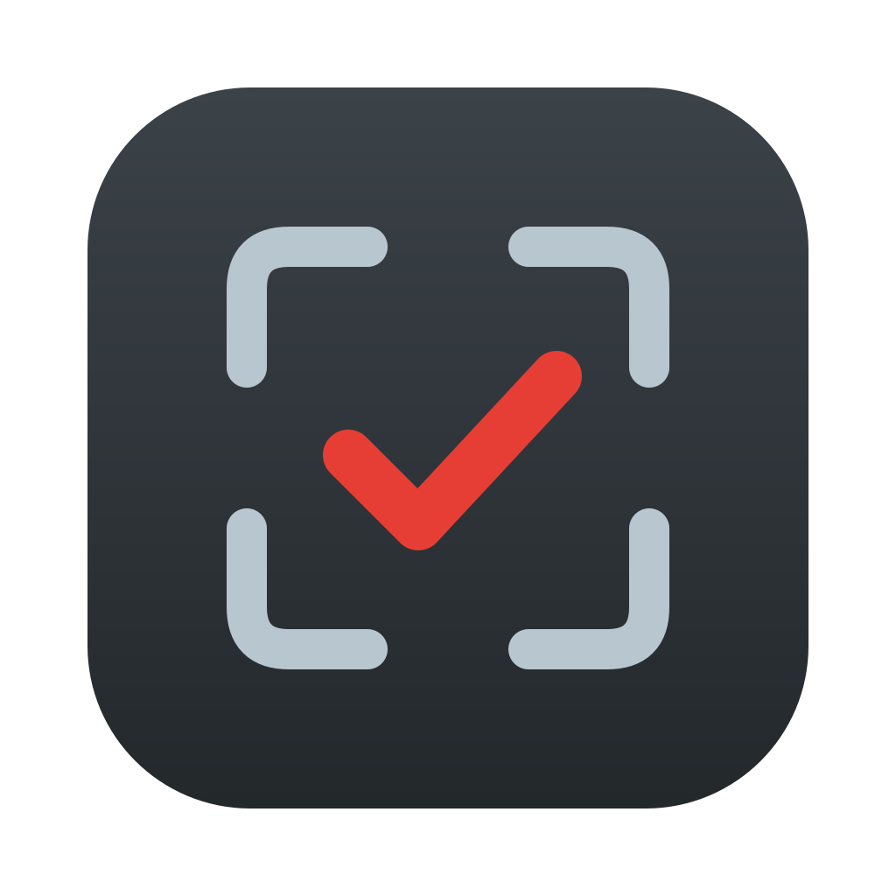

# Keepframe

**От карты памяти до аккуратной библиотеки — быстро, офлайн и без единого удалённого снимка.**

Импорт со сверкой контрольных сумм · отбор дублей и смазанных свайпами · просмотр всей библиотеки · ответ на вопрос «можно ли форматировать карту».

[Скачать](https://github.com/adobrov-cloud/keepframe/releases) · [English](README.md)

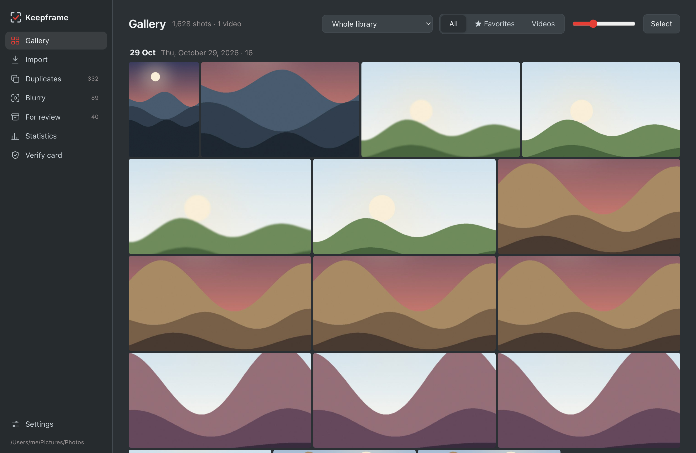

</div>

---

## Зачем

За день съёмки легко набираются сотни кадров: серии почти одинаковых снимков, несколько смазанных, пары JPG + RAW, пара видео. Разбирать это в Finder долго, а перед форматированием карты всегда сидит мысль «а всё ли скопировалось?».

Keepframe превращает это в дело нескольких минут:

1. **Вставили карту** — новые кадры копируются в папки по дням, каждая копия сверяется по SHA-256.
2. **Свайпнули** — оставляете или отбраковываете каждый новый кадр, либо приложение само находит серии и смазанные.
3. **Проверили** — приложение сравнивает каждый файл на карте с библиотекой по содержимому и прямо говорит: *можно форматировать*.

Ничего не удаляется. Отбракованное уходит в папки `_на проверку (…)` рядом с библиотекой, любое перемещение отменяется, а очищаете эти папки вы сами, когда уверены.

## Сценарии

**🧳 После поездки или выходных.** Включите *осознанный импорт*: сначала всё копируется, затем вы листаете новые кадры — → оставить, ← в отсев. Отсеянные кадры уходят на проверку вместе с RAW. Когда приложение скажет, что можно, — извлекайте карту.

**👶 Дети, животные, спорт — много серий.** *Дубли* собирают кадры, снятые с разницей в секунды и похожие друг на друга, и заранее отмечают самый резкий. Колёсиком увеличиваются все кадры серии разом в одной точке — сравниваете глаза, а не миниатюры.

**🌙 Мало света и длинная выдержка.** *Смазанные* находят кадры заметно мягче остальных за тот же день и показывают самое резкое место каждого в 100%, так что смаз и промах фокуса видны сразу. *Статистика* объясняет почему: привычки по ISO, выдержке и диафрагме и конкретные настройки, которые стоит поменять.

**🗂 Найти лучшие.** *Галерея* показывает всю библиотеку по дням вместе с видео. Звёздочки для избранного, множественный выбор с Shift/⌘, отсев пачкой, открыть в Просмотре или показать в Finder.

**💾 Перед форматированием карты.** *Проверка карты* считает хэши всех файлов на карте — включая видео, которые камера хранит вне `DCIM`, и форматы, которых приложение не знает, — и показывает, чего не хватает. Файл контрольных сумм сохраняется в библиотеке.

**📷 Любая камера.** JPG, HEIF и RAW от Fujifilm, Canon, Nikon, Sony, Olympus, Panasonic, Pentax, Leica, Hasselblad, Sigma, GoPro, DJI… Кто снимает только в RAW, получает всё то же: приложение берёт полноразмерное превью, которое камера встраивает в каждый RAW.

## Возможности

<table>
<tr>
<td width="50%">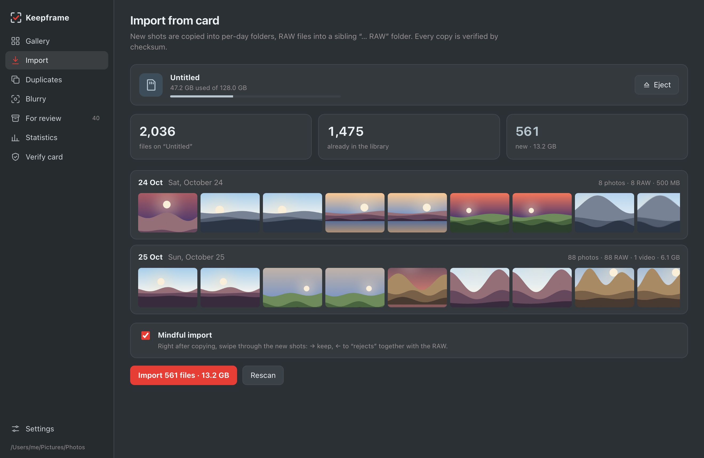</td>
<td width="50%">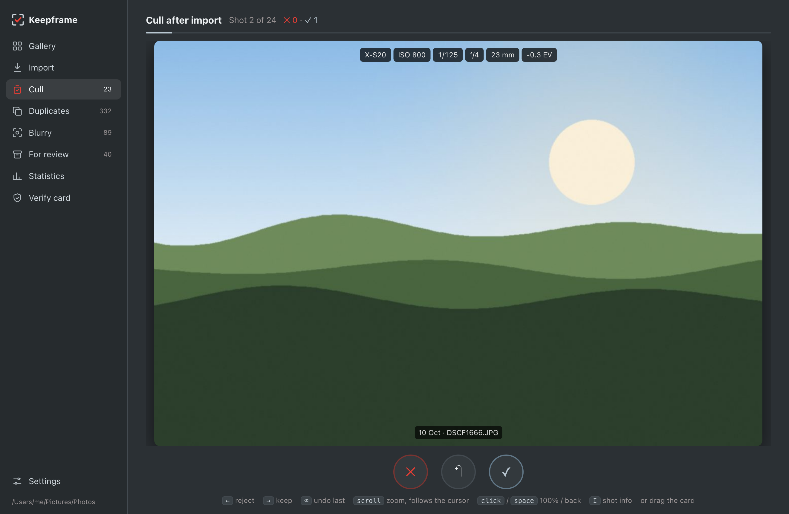</td>
</tr>
<tr>
<td><b>Импорт</b> — находит карту, показывает новое по дням с превью, копирует со сверкой. Объём карты и кнопка «Извлечь».</td>
<td><b>Осознанный импорт</b> — сразу после копирования листаете новые кадры: оставить или в отсев. Тянуть карточку мышью или стрелками.</td>
</tr>
<tr>
<td>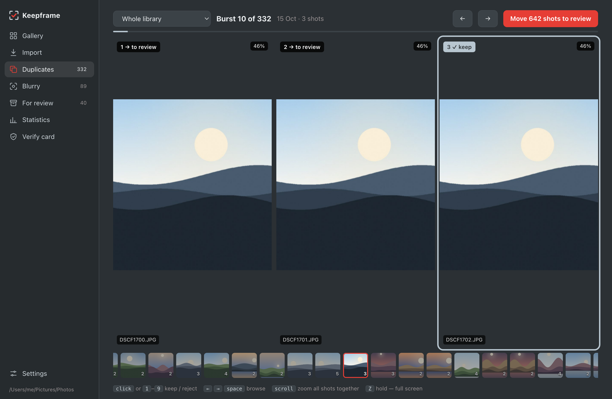</td>
<td>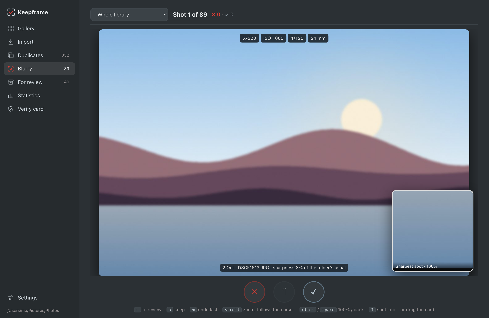</td>
</tr>
<tr>
<td><b>Дубли</b> — одна серия на экран, самый резкий выбран заранее, синхронный зум всех кадров, лента всех серий внизу.</td>
<td><b>Смазанные</b> — свайпы по мягким кадрам; лупа показывает самое резкое место в 100%, данные съёмки сверху.</td>
</tr>
<tr>
<td>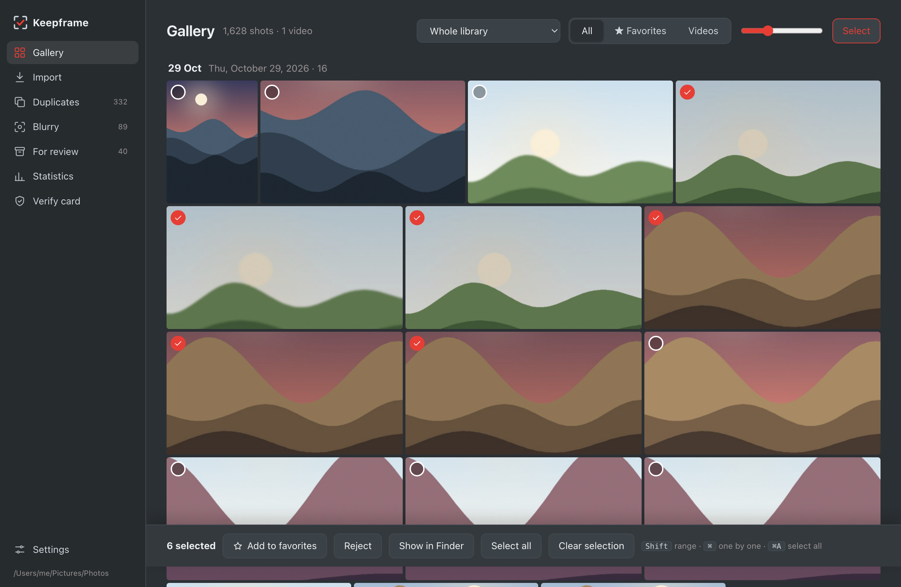</td>
<td>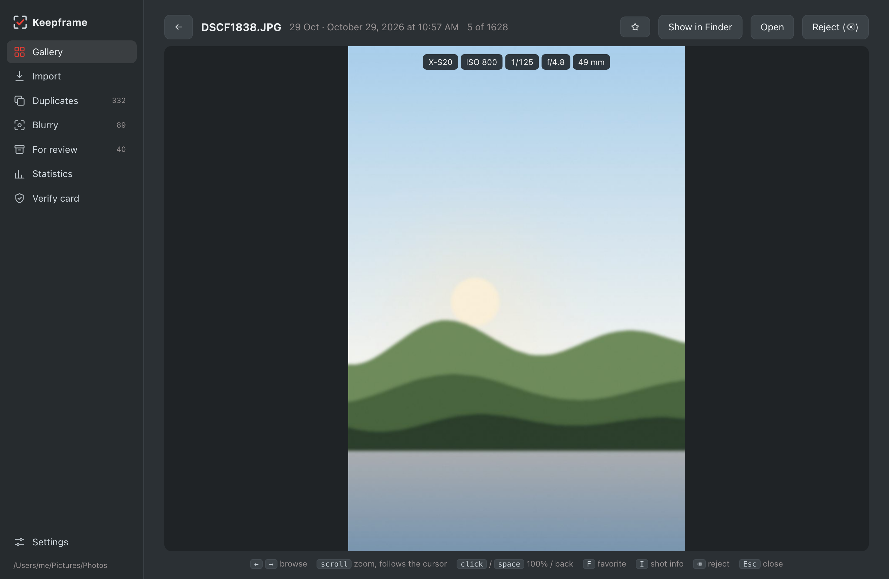</td>
</tr>
<tr>
<td><b>Галерея</b> — вся библиотека по дням, фото и видео, избранное, множественный выбор и действия пачкой.</td>
<td><b>Просмотр</b> — стрелки листают, колёсико увеличивает (область следует за курсором), щелчок — 100%, F — в избранное.</td>
</tr>
<tr>
<td>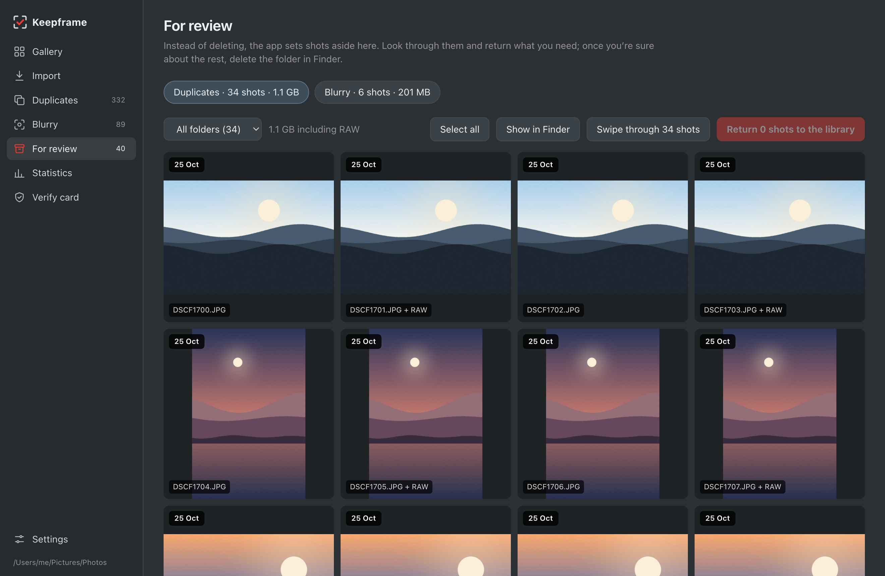</td>
<td>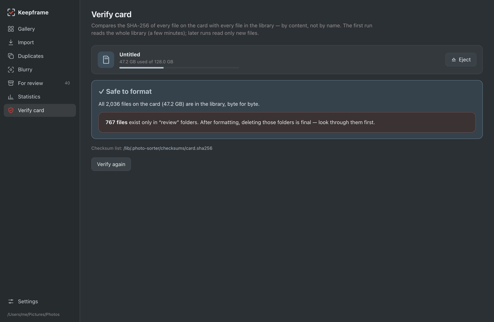</td>
</tr>
<tr>
<td><b>На проверке</b> — всё отложенное, по видам и дням. Вернуть на место по одному, пачкой или свайпами.</td>
<td><b>Проверка карты</b> — каждый файл карты сверяется с библиотекой по SHA-256, а не по имени.</td>
</tr>
<tr>
<td>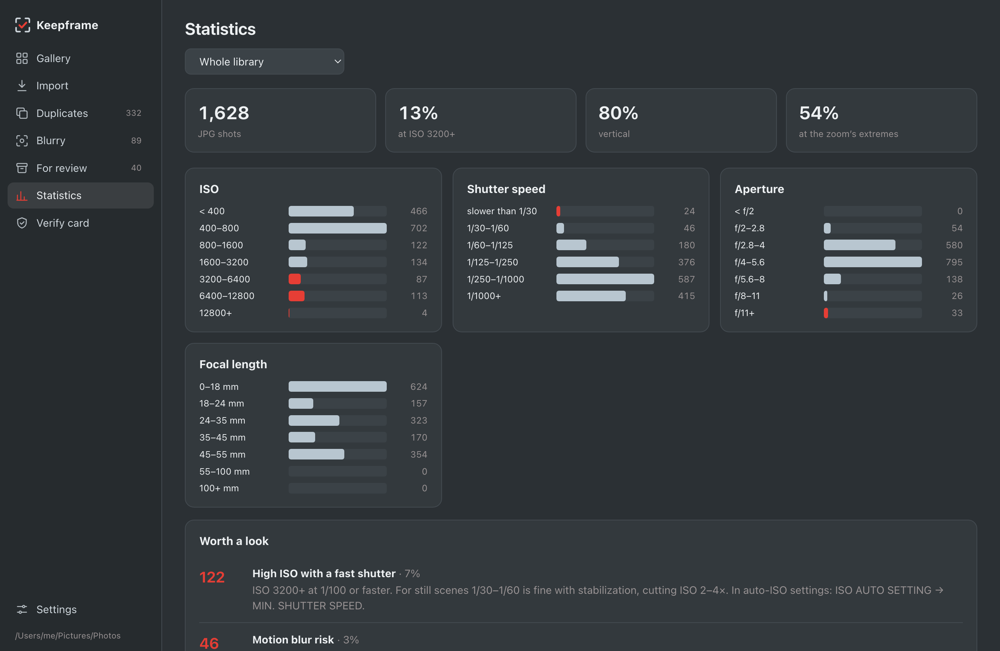</td>
<td>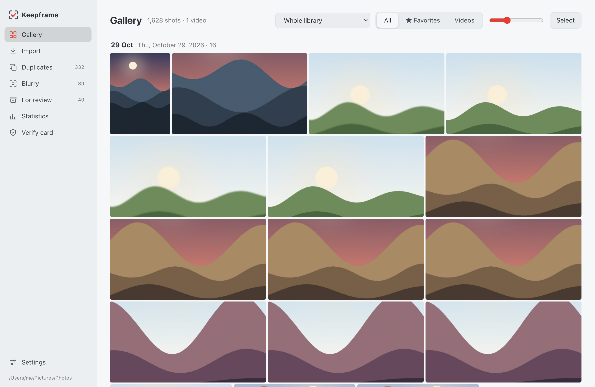</td>
</tr>
<tr>
<td><b>Статистика</b> — распределение ISO, выдержки, диафрагмы и фокусного с практическими советами.</td>
<td><b>Светлая и тёмная тема</b> — по системной. Родное окно macOS с полупрозрачной боковой панелью.</td>
</tr>
</table>

**13 языков:** English, Русский, Українська, Español, Português, Français, Deutsch, Italiano, Polski, Türkçe, 简体中文, 日本語, 한국어.

## Клавиши

| | Свайпы (Смазанные, Отбор после импорта, Возврат из проверки) | Дубли | Просмотр в галерее |
|---|---|---|---|
| ← / → | убрать / оставить | предыдущая / следующая серия | предыдущий / следующий |
| Колёсико | зум, следует за курсором | зум всех кадров разом | зум |
| Щелчок, пробел | 100% / обратно | щелчок: оставить / убрать; пробел: дальше | 100% / обратно |
| ⌫ | вернуть предыдущий | — | в отсев |
| 1–9 | — | оставить / убрать кадр N | — |
| I | данные съёмки | — | данные съёмки |
| F | — | — | избранное |
| Z (удерживать) | на весь экран | на весь экран | — |
| Esc | сбросить зум | сбросить зум | закрыть |

В галерее: **Shift-щелчок** — диапазон, **⌘/Ctrl-щелчок** — по одному, **⌘/Ctrl-A** — выбрать всё показанное.

## Установка

Сборка для вашей системы — на странице [Releases](https://github.com/adobrov-cloud/keepframe/releases):

| Система | Файл |
|---|---|
| macOS, Apple Silicon | `Keepframe_x.y.z_aarch64.dmg` |
| macOS, Intel | `Keepframe_x.y.z_x64.dmg` |
| Windows | `Keepframe_x.y.z_x64-setup.exe` |
| Linux | `.deb`, `.rpm` или `.AppImage` |

Платного сертификата Apple / Microsoft у приложения пока нет:

- **macOS** — при первом запуске откройте *System Settings → Privacy & Security* и нажмите *Open Anyway*. Если macOS пишет, что приложение повреждено, выполните в Terminal `xattr -cr "/Applications/Keepframe.app"`.
- **Windows** — SmartScreen может предупредить о неизвестном издателе: *Подробнее → Выполнить в любом случае*.

## Как устроено

Всё работает на вашем компьютере: без сети, аккаунта и телеметрии.

| | |
|---|---|
| **Сверка копий** | Каждый файл хэшируется (SHA-256) во время копирования; копия перечитывается и сравнивается, и только потом получает своё имя. |
| **Проверка карты** | Все файлы карты, кроме служебных файлов камеры (базы, миниатюры, прокси), хэшируются и ищутся в библиотеке по содержимому. Хэши библиотеки кэшируются, поэтому повторно читаются только новые файлы. |
| **Серии** | 64-битный разностный хэш (dHash) каждого кадра; соседние кадры с разницей ≤ 15 с и расстоянием Хэмминга ≤ 12 образуют серию. |
| **Резкость** | Дисперсия лапласиана в самом резком из 16 фрагментов (резкий объект на размытом фоне всё равно считается резким) относительно остальных кадров того же дня. |
| **RAW и HEIF** | Из RAW берётся полноразмерное JPEG-превью, встроенное камерой; HEIF на macOS переводится системной утилитой `sips`. |
| **Безопасность** | Перемещения идут в папки `_на проверку (…)` с журналом для отмены; избранное и кэши — в `<библиотека>/.photo-sorter/`. Сами фото никогда не меняются и не удаляются. |

Сделано на [Tauri 2](https://tauri.app) (Rust) и простом HTML/CSS/JS — около 12 МБ после установки.

## Сборка из исходников

Нужны [Rust](https://rustup.rs) и Node.js.

```bash
npm install
npx tauri dev                    # запуск в режиме разработки
npx tauri build --bundles app    # macOS .app в src-tauri/target/release/bundle
```

Windows и Linux собираются так же (`npx tauri build`). Пуш тега `v*` собирает все платформы в GitHub Actions и публикует релиз.

**Тесты.** Сквозной тест бэкенда на настоящих файлах — `PS_CARD` папка с `DCIM`, `PS_LIB` пустая папка-библиотека:

```bash
cd src-tauri && PS_CARD=/path/to/card PS_LIB=/tmp/lib cargo test --release -- --nocapture
```

**Интерфейс без бэкенда.** Раздайте корень репозитория (`python3 -m http.server`) и откройте `/mock/index.html` — стенд отвечает на все вызовы бэкенда демо-данными. `?scene=gallery&lang=ru` открывает готовый экран — так сделаны скриншоты выше. Демо-картинки — сгенерированные пейзажи, а не настоящие фото.

## Планы

- Бэкап на внешний диск или NAS с той же сверкой контрольных сумм
- «RAW только для лучших»: освободить место, отложив RAW кадров без звёздочки
- Экспорт уменьшенных копий для мессенджеров и AirDrop
- Слайд-шоу, календарь, поиск по камере и объективу
